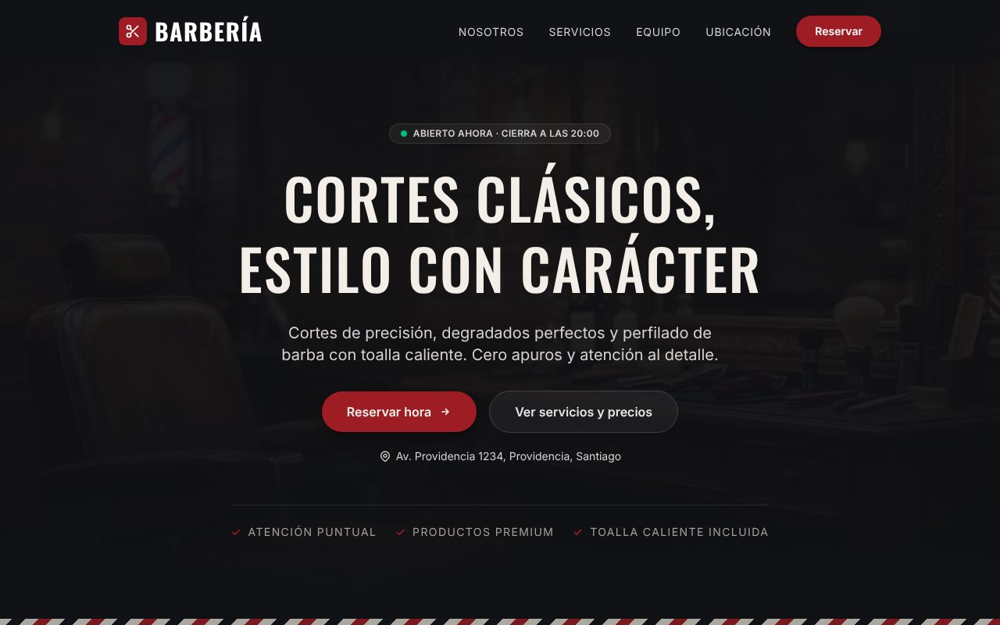
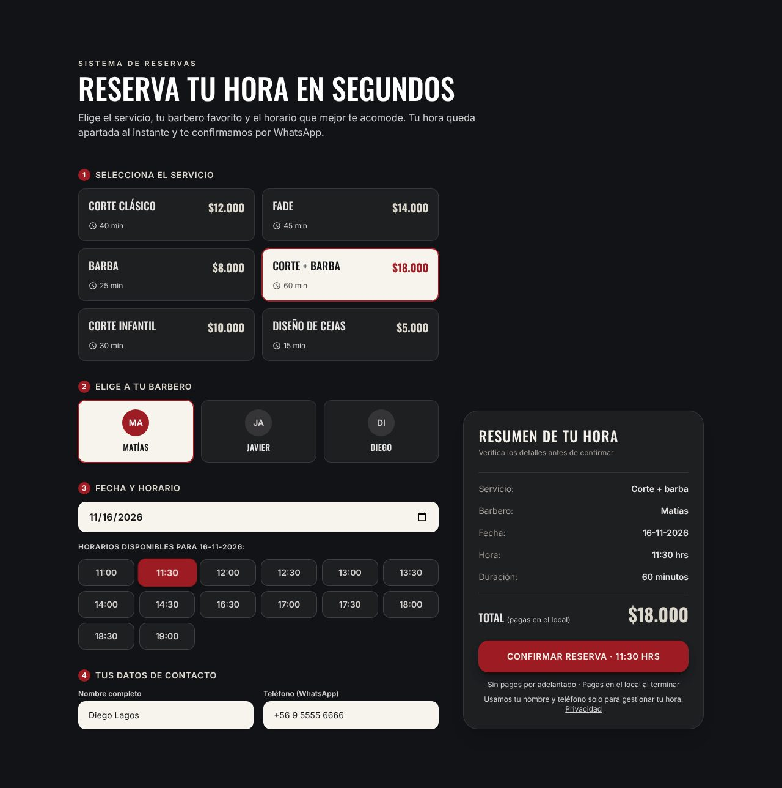
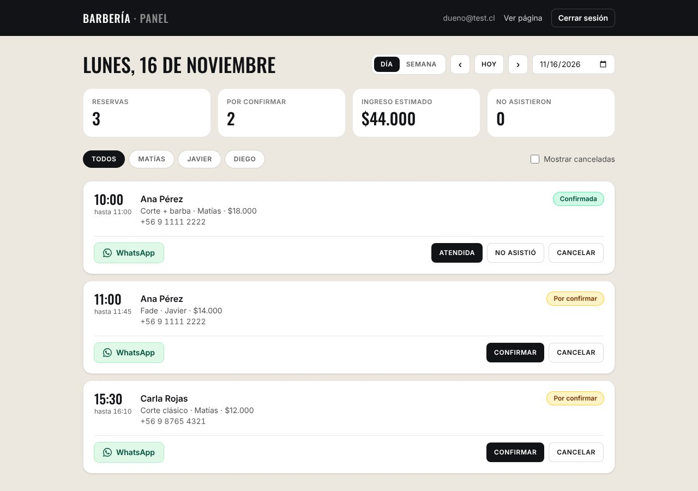
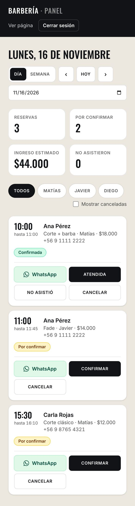
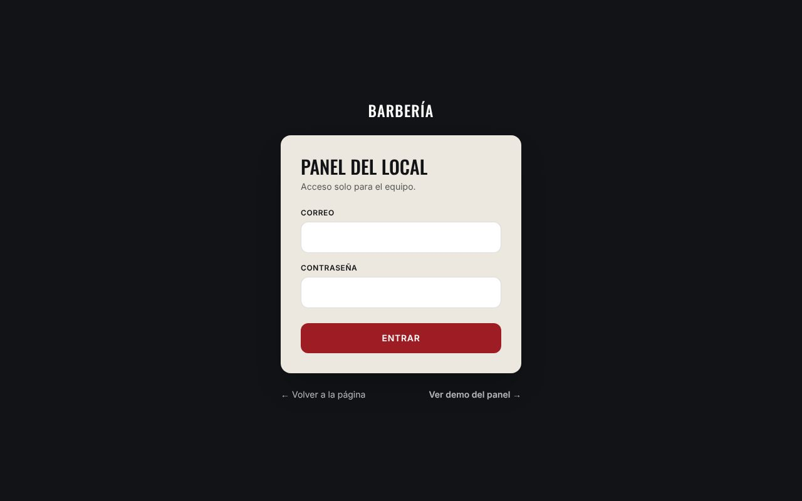
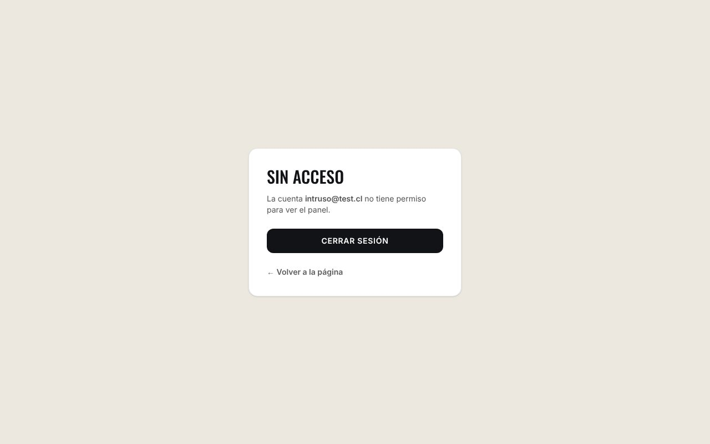

# Barbería · página con reservas en línea y panel del dueño

Página web para una barbería de barrio en Santiago. Los clientes ven los servicios y **reservan una
hora en línea sin crear cuenta**. El dueño entra a un **panel privado** donde confirma, cancela y
escribe a cada cliente por WhatsApp.

Es un proyecto de portafolio: el negocio, los barberos y los precios son de ejemplo. Está pensado
como base para ofrecer páginas con reservas a pymes chilenas.

**Demo en vivo:** _pendiente de publicar_ · **Demo del panel sin contraseña:** `/admin/demo`



## Qué hace

**Para el cliente**
- Elige servicio, barbero, día y una de las horas libres, que se calculan en vivo según el horario
  de cada barbero y las reservas existentes.
- Deja solo su nombre y teléfono. La hora queda apartada y el local confirma por WhatsApp.
- Ve si el local está abierto ahora, el mapa, las preguntas frecuentes y un botón flotante de WhatsApp.

**Para el dueño (`/admin`)**
- Login con correo y contraseña. Solo entran las cuentas marcadas como administrador **en la base de datos**.
- Reservas del día o de la semana, con filtro por barbero y resumen: total, por confirmar, ingreso
  estimado y no asistieron.
- Confirmar, marcar atendida o no asistió, cancelar (con doble confirmación) y reactivar.
- Botón de WhatsApp con el mensaje de confirmación ya escrito.
- Se actualiza solo y funciona en el celular.

| Reserva | Panel del dueño |
|---|---|
|  |  |

| Panel en el celular | Login | Cuenta sin permiso |
|---|---|---|
|  |  |  |

## Tecnologías

| | |
|---|---|
| Interfaz | React 19, TypeScript, Tailwind CSS v4, React Router 7 |
| Herramientas | Vite 8, oxlint, Vitest |
| Base de datos y login | Supabase (PostgreSQL + Supabase Auth) |
| Publicación | Vercel (con cabeceras de seguridad y CSP) |
| Integración continua | GitHub Actions: lint, pruebas, build y pruebas de seguridad de la base en cada PR |

## Decisiones técnicas

**El navegador nunca toca las tablas con datos de clientes.**

- `reservas`, `horarios` y `administradores` tienen Row Level Security y se les quitó todo
  permiso al público (`revoke`).
- Todo pasa por funciones SQL `security definer` que validan cada caso: `horas_disponibles`,
  `crear_reserva` y `admin_*`.
- Aunque alguien copie la clave publicable del código, no puede leer nombres ni teléfonos.

**Los permisos del panel se revisan en la base, no solo en React.**

- Cada función del panel llama a `es_admin()`, que compara `auth.uid()` con la tabla `administradores`.
- Si alguien se salta la interfaz y llama a la API directamente, recibe `NO_AUTORIZADO`.

**Es imposible reservar dos veces la misma hora**, aunque dos personas aprieten "Confirmar" en el
mismo segundo.

- Lo impide una restricción de PostgreSQL:
  `exclude using gist (barbero_id with =, tstzrange(inicio, fin) with &&)`.
- No depende del código de la página: es la base la que rechaza la segunda reserva.

**Frenos contra abuso en la reserva pública**, todos en SQL:

- Hasta 30 días hacia adelante.
- Máximo 2 reservas futuras por teléfono. El número se normaliza, así que `+56 9…`, `569…` y
  `9…` cuentan como el mismo, y un bloqueo (`pg_advisory_xact_lock`) evita que dos peticiones
  simultáneas se salten el límite.
- Máximo 30 reservas nuevas por hora en todo el local.

**Todo en hora de Chile.**

- Las horas se guardan como `timestamptz` y se calculan en `America/Santiago`.
- Así el horario funciona igual con el cambio de hora y aunque el computador del visitante esté
  en otra zona.

**Login cuidadoso.**

- El mismo mensaje para correo inexistente y para contraseña mala.
- Registro público desactivado.
- La página se niega a arrancar si alguien pega la clave secreta en lugar de la publicable.

**Demo del panel sin publicar contraseñas.**

- `/admin/demo` usa el mismo componente del panel con una fuente de datos inventada
  (`src/admin/fuente.ts`).
- Quien revise el proyecto puede probar el panel completo sin cuenta y sin tocar la base real.

## Pruebas

**39 pruebas de seguridad de la base, 25 pruebas unitarias y 34 comprobaciones de punta a punta
en el navegador, todas pasando.** El detalle de qué se probó y cómo está en
[docs/PRUEBAS.md](docs/PRUEBAS.md).

```bash
npm test          # pruebas unitarias (Vitest)
npm run lint      # revisión de código
npm run build     # TypeScript + build
npm run verificar # revisa la conexión y los permisos contra TU Supabase (no cambia nada)
```

`supabase/verificar.sql` se pega en el SQL Editor de Supabase y comprueba, con los roles reales,
que el público no pueda leer reservas, que un usuario sin permiso no vea el panel, que funcionen los
límites, etc. Deshace todo al terminar.

## Correr en tu computador

```bash
npm install
npm run dev
```

- Página: <http://localhost:5173>
- Demo del panel: <http://localhost:5173/admin/demo>

Sin `.env.local` la página funciona igual: la reserva muestra un botón de WhatsApp y la demo del
panel funciona. Para conectar tu propia base:

1. Crea un proyecto en [Supabase](https://supabase.com) y corre en el SQL Editor `supabase/schema.sql`
   y luego `supabase/migraciones/002_login_dashboard.sql`. Al inicio de ese archivo están los pasos
   para crear el usuario del dueño.
2. Copia `.env.example` como `.env.local` con la URL del proyecto y la **clave publicable**.
3. Corre `npm run verificar`.

Para publicar en Vercel: [docs/DESPLIEGUE.md](docs/DESPLIEGUE.md).

## Estructura

```
src/
  components/   secciones de la página pública (Hero, Servicios, Reserva…)
  admin/        panel del dueño: login, panel, demo y fuente de datos
  data/         contenido editable: negocio, servicios, barberos
  lib/          cliente de Supabase, horario y teléfonos
supabase/
  schema.sql    tablas, seguridad y reservas (etapa 1)
  migraciones/  login, panel y frenos contra abuso (etapa 2)
  verificar.sql pruebas de seguridad para correr en Supabase
scripts/        verificar-conexion.mjs (npm run verificar)
docs/           informe de pruebas, despliegue y capturas
```

El contexto completo para trabajar en el código (reglas, base de datos, deuda conocida) está en
[AGENTS.md](AGENTS.md). Sirve tanto para personas como para asistentes de IA.

## Próximos pasos

- Captcha (Cloudflare Turnstile) validado en una Edge Function.
- Bloquear días y horas (feriados, vacaciones) y editar servicios desde el panel.
- Recordatorio automático el día antes.
- Borrado automático de reservas de más de 12 meses.
- Cuentas de clientes: historial y cancelar su propia hora.

## Licencia

[MIT](LICENSE)
