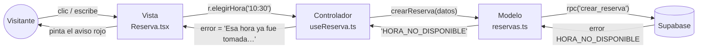

# Arquitectura: Modelo · Vista · Controlador

El código de `src/` está separado en tres capas. Cada una tiene un solo trabajo:

| Capa | Carpeta | Su trabajo | Qué NO hace |
|---|---|---|---|
| **Modelo** | `src/modelos/` | Los datos y las reglas del negocio: qué servicios hay, cómo se valida un teléfono, en qué hora de Chile estamos, cómo se pide algo a Supabase. | No sabe que existe React ni una pantalla. No escribe mensajes para el usuario: devuelve datos o un **código** (`'HORA_NO_DISPONIBLE'`). |
| **Controlador** | `src/controladores/` | Guarda lo que el usuario va eligiendo (el estado), llama al modelo cuando hace falta y decide qué mensaje mostrar. | No dibuja nada (no devuelve JSX). |
| **Vista** | `src/vistas/` | Dibuja la pantalla con lo que le entrega el controlador y le avisa cuando el usuario hace clic o escribe. | No llama a Supabase ni decide reglas del negocio. |



## Cómo se ve en React

React no trae MVC "de fábrica", así que aquí se adaptó así:

- **Modelo** = archivos `.ts` normales con funciones (`crearReserva`, `telefonoValido`, `hoyChile`)
  y tipos (`tipos.ts`). Como no usan React, se pueden probar con Vitest sin abrir un navegador.
- **Controlador** = un **hook** por pantalla (`useReserva`, `usePanel`, `useLogin`, `useSesionAdmin`).
  Un hook es una función cuyo nombre empieza con `use` (eso lo exige React) y que puede usar
  `useState` y `useEffect`. Devuelve un objeto con los datos y las acciones para la vista.
- **Vista** = los componentes `.tsx`. Llaman a su hook y solo dibujan:

```tsx
// vistas/publica/Reserva.tsx (resumido)
export default function Reserva() {
  const r = useReserva()          // ← controlador: todo el estado y la lógica
  return (
    <button onClick={() => r.elegirHora(h)}>{h}</button>   // ← la vista solo avisa y dibuja
  )
}
```

## Ejemplo completo: alguien reserva una hora que ya estaba tomada

1. **Vista** (`Reserva.tsx`): la persona aprieta "Confirmar". El `<form>` llama a `r.enviar()`.
2. **Controlador** (`useReserva.ts`):
   - `enviar()` revisa que haya hora, nombre y teléfono, usando `telefonoValido()` del modelo.
   - Si está todo, llama a `crearReserva(...)`.
3. **Modelo** (`reservas.ts`): `crearReserva()` limpia el teléfono y llama a la función SQL
   `crear_reserva` de Supabase. La base responde con el error `HORA_NO_DISPONIBLE`, y el modelo
   devuelve solo ese código.
4. **Controlador**: busca el texto en `mensajes.ts` ("Esa hora ya fue tomada…"), borra la hora
   elegida y vuelve a pedir las horas libres.
5. **Vista**: React la vuelve a dibujar sola, con el aviso rojo y la lista de horas nueva.

Si mañana el mensaje cambia, se toca solo `mensajes.ts`. Si mañana se cambia Supabase por otra
base, se toca solo `modelos/`. Si cambia el diseño, se toca solo `vistas/`.

## Qué hay en cada carpeta

```
src/modelos/        MODELO
  tipos.ts          forma de cada dato
  datos/            negocio, servicios y barberos (se editan a mano)
  supabase.ts       cliente de Supabase + codigoDeError()
  reservas.ts       reserva pública: cargarCatalogo, horasDisponibles, crearReserva
  sesion.ts         login: iniciarSesion, cerrarSesion, esAdmin, alCambiarSesion
  panel.ts          panel: fuenteReal (Supabase) y fuenteDemo (datos inventados)
  fechas.ts · horario.ts · telefono.ts · enlaces.ts · formato.ts   reglas y formatos

src/controladores/  CONTROLADOR
  useReserva.ts     formulario de reserva
  useSesionAdmin.ts qué pantalla de /admin mostrar
  useLogin.ts       formulario de login
  usePanel.ts       panel del dueño (y useFuenteDemo para /admin/demo)
  mensajes.ts       código del modelo → texto para el usuario
  pedirReserva.ts   "Reservar este" desde las tarjetas hasta el formulario

src/vistas/         VISTA
  publica/          página "/" (Navbar, Hero, Servicios, Equipo, Reserva, Footer…)
  admin/            /admin y /admin/demo (Admin, Login, Panel, TarjetaReserva, Demo)
  paginas/          /privacidad y 404
  comunes/          íconos que usan varias vistas
```

## Reglas (las revisa el agente `revisor-codigo`)

1. `modelos/` **no importa** React ni nada de `controladores/` o `vistas/`.
2. `controladores/` no devuelve JSX y no usa clases de Tailwind.
3. `vistas/` **nunca importa** `modelos/supabase.ts` ni llama a la base. Sí puede leer datos
   fijos (`modelos/datos/`) y usar funciones de formato (`pesos`, `fechaLarga`), porque solo leen.
4. Estado puramente visual puede quedarse en la vista, sin controlador: el menú abierto en
   `Navbar`, el botón de WhatsApp que aparece al bajar o la foto que no cargó.
5. Los errores viajan como **código** desde el modelo y se convierten en texto en
   `controladores/mensajes.ts`. TypeScript avisa si un código no tiene texto.

Para revisar las reglas 1 y 3 rápido:

```bash
grep -rn "from 'react'" src/modelos          # debe salir vacío
grep -rn "modelos/supabase" src/vistas       # debe salir vacío
```

## Qué cambió respecto de la versión anterior

| Antes | Ahora | Por qué |
|---|---|---|
| `components/Reserva.tsx`, de 634 líneas: estado, llamadas a Supabase, textos de error y diseño juntos | `vistas/publica/Reserva.tsx` (diseño) + `controladores/useReserva.ts` (estado) + `modelos/reservas.ts` (Supabase) | Cada pieza se entiende y se cambia por separado |
| `admin/Admin.tsx` y `admin/Login.tsx` llamaban a `supabase.auth` directamente | `modelos/sesion.ts` + `useSesionAdmin` + `useLogin` | La vista no sabe que existe Supabase |
| `admin/Panel.tsx`: filtros, resumen y recargas dentro del componente | `controladores/usePanel.ts` | El panel real y la demo comparten la misma lógica |
| `admin/util.ts` mezclaba tipos, fechas, colores, enlaces y mensajes | Repartido: `tipos.ts`, `fechas.ts`, `enlaces.ts` (modelo), `mensajes.ts` (controlador) y colores en `TarjetaReserva.tsx` (vista) | Cada cosa en la capa que le corresponde |
| El enlace `https://wa.me/…` del local escrito en 5 archivos | `whatsappDelLocal()` en `modelos/enlaces.ts` | Si cambia el número o el formato, se toca un lugar |
| Las tarjetas de Servicios y Equipo repetían el código del evento y el scroll | `pedirReserva()` en `controladores/pedirReserva.ts` | Un solo lugar para "Reservar este" |
| `data/`, `lib/`, `types.ts` sueltos en `src/` | Dentro de `modelos/` | Se ve de inmediato qué es dato y qué es pantalla |

El funcionamiento de la página no cambió. Lo comprueban las mismas pruebas de antes (unitarias,
de la base y en el navegador): ver `docs/PRUEBAS.md`.
